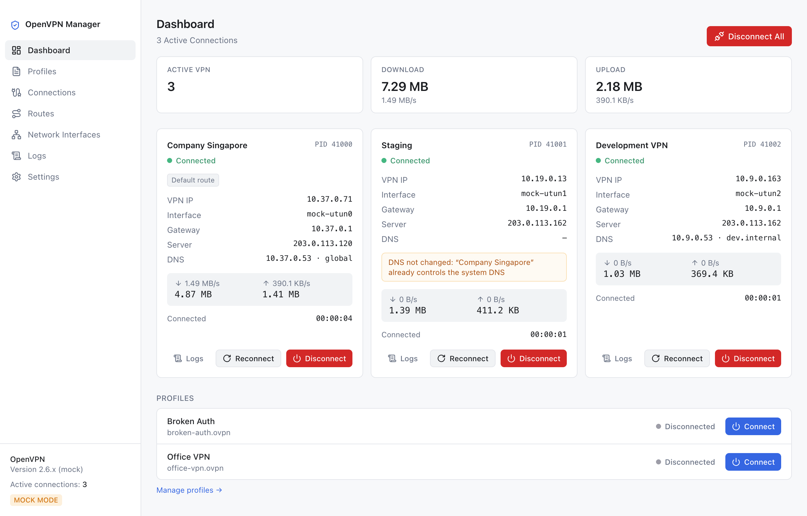
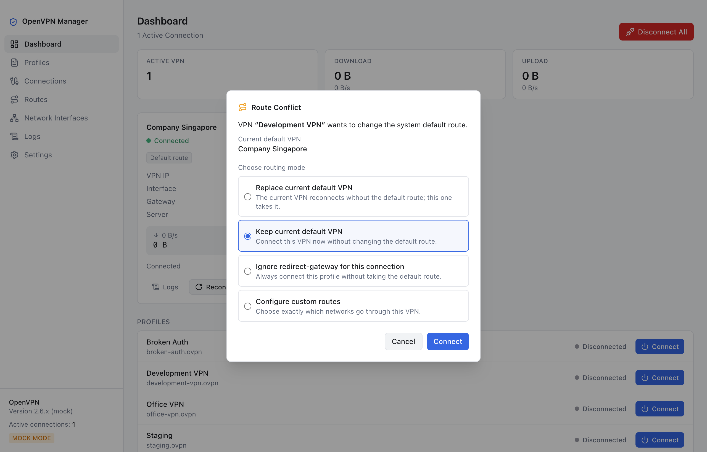
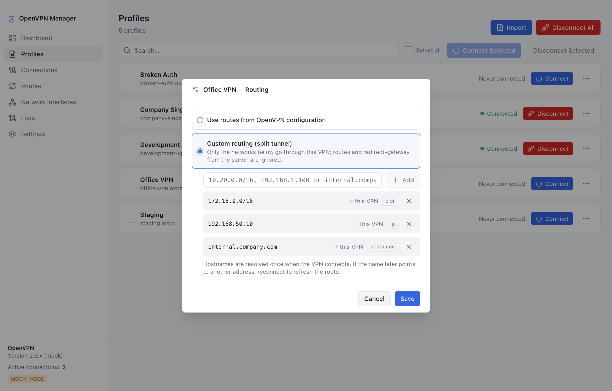
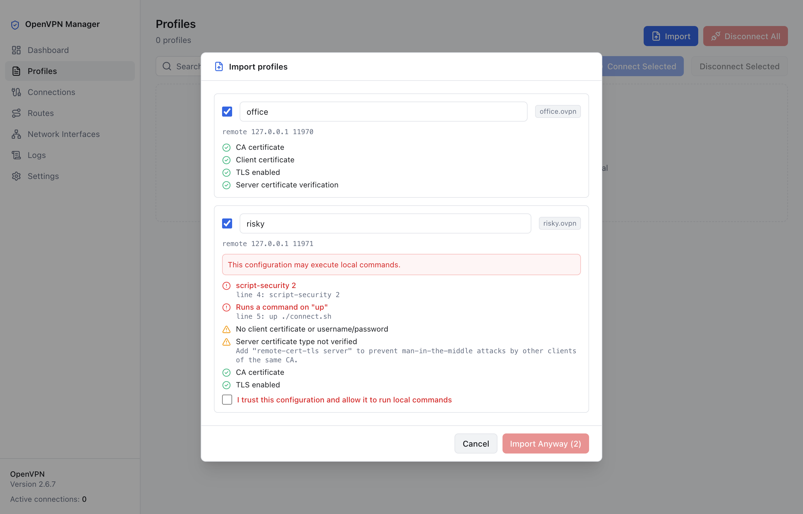

<p align="center">
  
</p>

<h1 align="center">Multi OpenVPN</h1>

<p align="center">
  Connect to several OpenVPN networks at the same time — and always know where your traffic goes.
</p>

<p align="center">
  macOS (Intel & Apple Silicon) · Windows x64
</p>

---



## Why

Most VPN clients connect to one network at a time. If you work with an office network, a
development environment and a client's infrastructure, you end up disconnecting and
reconnecting all day.

Multi OpenVPN keeps all of them up together. Each profile runs as its own OpenVPN connection,
and the app stops them from fighting over your internet traffic and DNS.

```text
Internet        → your normal connection
10.20.x.x       → Company VPN
172.16.x.x      → Development VPN
192.168.50.x    → Office VPN
```

## Features

**Several VPNs at once**
- Connect, disconnect or reconnect each VPN on its own; one dropping never affects the others.
- Live status, VPN address, network interface, traffic and connection time for every VPN.
- Connect several profiles in one click, or disconnect all of them.

**Routing you stay in control of**
- Only one VPN at a time may take over all your internet traffic. If a second one asks for it,
  the app asks you what to do instead of silently switching.
- Split tunneling: choose exactly which networks, addresses or hostnames go through a VPN.
- A route inspector shows which network goes through which VPN.

**DNS that does not break**
- Company domains are sent to that company's VPN DNS, so several VPNs can each resolve their
  own names at the same time.
- Choose per profile: use the VPN's DNS, keep your own, or set custom servers.
- Your original DNS settings come back when a VPN disconnects — even after a crash.

**Simple, safe profile management**
- Import `.ovpn` / `.conf` files by drag & drop, several at once. Certificates referenced by the
  file are copied in automatically.
- Every imported profile is checked for risky settings, such as running local scripts, and you are
  warned before importing it.
- View, edit, duplicate and export profiles. An export is a single `.ovpn` file with the
  certificates included.

**Security**
- Passwords can be remembered securely, protected by the macOS Keychain or Windows data protection
  (DPAPI). They are never stored in plain text, and only after they have been accepted.
- The app runs as your normal user. Only a small helper has administrator rights. It accepts a
  short list of checked operations and never runs scripts from VPN profiles.

**Everyday comfort**
- Clear error messages ("The VPN server rejected your username or password") instead of raw logs,
  plus a separate, searchable log for every VPN.
- Automatic reconnect with increasing delays. It stops retrying when a retry cannot succeed, such
  as a wrong password or an expired certificate.
- Menu bar / system tray menu, start at login, connect chosen profiles automatically.
- Light and dark mode.

## Screenshots

| | |
|---|---|
|  |  |
| **Route conflict** — you decide which VPN carries your internet traffic | **Split tunneling** — send only chosen networks through a VPN |
|  | |
| **Import** — every profile is checked before it is added | |

## Requirements

- macOS 12 or later (Intel or Apple Silicon), or Windows 10/11 x64.
- [OpenVPN Community](https://openvpn.net/community-downloads/) 2.5 or later. On macOS, for example:
  `brew install openvpn`. The app finds it automatically.
- Administrator rights once, to install the network helper. On macOS: Settings → Privileged
  helper. On Windows the installer installs it.

Multi OpenVPN works with standard OpenVPN servers. It uses the official OpenVPN software for the
connections themselves, so your existing `.ovpn` files work as they are.

## Download

Get the latest version from the [Releases](../../releases) page:

| System | File |
|---|---|
| macOS, Apple Silicon | `Multi OpenVPN-<version>-arm64.dmg` |
| macOS, Intel | `Multi OpenVPN-<version>-x64.dmg` |
| Windows (installer) | `Multi OpenVPN-Setup-<version>.exe` |
| Windows (portable, no helper) | `Multi OpenVPN-<version>-portable.exe` |

> **Early release.** Builds are not yet code-signed. macOS may ask you to confirm opening the app
> (right-click → Open), and Windows SmartScreen may show a warning. The Windows version is new
> and has had less testing than the macOS version.
